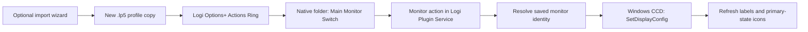

# Logi Monitor Switcher

**Make any connected display your Windows main monitor, directly from Logi Options+ Actions Ring.**

[](https://github.com/flyrobin620/logi-monitor-switcher/actions/workflows/ci.yml)
[](LICENSE)

English | [简体中文](README.zh-CN.md)


Switch between a desk display, a TV, and a portrait monitor without opening Windows Display Settings:

```text
Actions Ring
└── Main Monitor Switch
    ├── Monitor 1 — your desk display
    ├── Monitor 2 — your TV       ★ Main
    └── Monitor 3 — your portrait display
```

> **Independent, community-built Windows plugin.** Not affiliated with or endorsed by Logitech. This is not a monitor-input/KVM switch: it changes the **primary display in Windows**, not HDMI/DisplayPort inputs, power, or brightness.

## What you get

| Feature | Behavior |
| --- | --- |
| Two-level menu | A native Actions Ring folder containing one action per selected monitor. |
| Real monitor names | Hardware-reported model names, resolution, and current monitor number instead of only “Generic PnP Monitor.” |
| Readable icons | A monitor outline with a large number; the main display has a green outline **and a gold star**. |
| Live main-display state | Refreshes after plugin switching; external changes are normally detected within about three seconds. |
| Stable bindings | Uses device-interface identity rather than assuming `DISPLAY1/2/3` never change. Existing bindings from the original project remain supported. |
| Import wizard | Generates a separate `.lp5` profile with the folder, selected monitors, and a dedicated parent icon. Your original profile is preserved. |
| No tray-app dependency | Runs inside **Logi Plugin Service**. No hotkey simulation, local HTTP server, or separate resident helper. |

**Important distinction:** names and main-display icons refresh automatically, but native folder **membership does not**. After adding or replacing monitors, regenerate/import a profile or update its assignments manually. One native folder supports up to **nine** monitor actions.

## Requirements

| Component | Requirement |
| --- | --- |
| Operating system | Windows 10 or 11, with the displays enabled in the Windows desktop. |
| Logitech software | [Logi Options+](https://www.logitech.com/software/logi-options-plus.html) with **Logi Plugin Service** installed and running. |
| Device | A device supported by Options+ Actions Ring; confirm that Actions Ring is available for your device. |
| Building from source | [.NET 10 SDK](https://dotnet.microsoft.com/download/dotnet/10.0) and the installed host's `PluginApi.dll`. |
| Standalone import wizard | .NET 10 **Desktop Runtime**, or the Windows .NET 10 SDK. The wizard is framework-dependent. |

The implementation has been exercised with Windows and Logi Plugin Service **6.4.2.3414**. Logitech's SDK and profile format can change; compatibility with every host version/device is not guaranteed. The plugin uses the runtime supplied by the Logitech host.

## Quick start

### 1. Build the plugin

Open PowerShell on Windows:

```powershell
git clone https://github.com/flyrobin620/logi-monitor-switcher.git
Set-Location .\logi-monitor-switcher
.\build.ps1
```

The build reads `PluginApi.dll` from the local Logi Plugin Service installation. It does **not** install the plugin, edit your ring, or switch displays.

For custom installation paths:

```powershell
.\build.ps1 -Dotnet 'C:\Tools\dotnet\dotnet.exe' `
  -PluginApiDir 'C:\Program Files\Logi\LogiPluginService'
```

Build outputs:

| File | Purpose |
| --- | --- |
| `dist\MonitorSwitcher_1.0.0.lplug4` | Plugin installation package. |
| `dist\MonitorSwitcher-Setup_1.0.0.zip` | Optional import wizard; extract the entire archive before running its EXE. |
| `dist\SHA256SUMS.txt` | SHA-256 hashes of both packages. |

Versioned filenames follow `src\MonitorSwitcher.Plugin\package\metadata\LoupedeckPackage.yaml`. Logitech's SDK DLL, debug symbols, personal profiles, logs, and local SDK paths are **not** included in these distribution archives.

### 2. Install in Options+

1. Double-click the generated `.lplug4` package and complete Logitech's installation flow.
2. Open **Actions Ring → Customize Ring** in Options+.
3. Check that **Monitor Switcher → Main Monitor Switch** is available in the action picker.

If the host does not pick up the installation, exit Options+, restart the **`LogiPluginService.exe` process**, and reopen Options+. This is the plugin host, not necessarily the similarly named Windows service.

The plugin is installed locally; building this repository does not publish it to Logitech Marketplace.

### 3. Create the second-level menu

**Recommended: use the import wizard.**

```powershell
.\setup.ps1
```

1. Select the Actions Ring profile you want to copy. For a general-purpose ring, choose the system/global profile.
2. Select **1–9 displays**. If the profile has no `Main Monitor Switch` folder, choose the root slot to replace **in the copy**.
3. Click **Generate import file** and save the `.lp5` outside Logitech's profile directory.
4. In the Options+ profile menu, choose **Import profile**, select that file, then select the imported profile.
5. Open Actions Ring → **Main Monitor Switch** → select a monitor.

The wizard rebuilds an existing `Main Monitor Switch` folder in the copy instead of creating a duplicate. It preserves other actions, assigns new profile/package IDs, and embeds the double-monitor/switch-arrow parent icon. Monitor actions retain their **live** icons, not a snapshot of whichever display was primary during import.

Keep the original profile until the imported copy works as expected. The wizard supports the observed `Loupedeck72` profile schema and fails explicitly for unsupported structures. Creating a new folder requires a profile with a single mode, workspace, and ring page.

**Manual alternative:** create a native folder named `Main Monitor Switch`, then drag the monitor actions into it. The parent icon is generated at `artifacts\plugin\icons\MainMonitorSwitch.svg` and `.ict`; apply it through the Options+ icon editor. Do not replace child icons with static images if you want the main-display star to update.

> Changing the primary display can move taskbars and affect where applications open. The plugin preserves relative desktop positions by translating the selected display to `(0,0)`; it does not choose a new resolution or intentionally rearrange screens.

## How it works



- `EnumDisplayDevices` and `EnumDisplaySettings` enumerate active desktop sources.
- `DisplayConfigGetDeviceInfo` supplies real monitor names, joined by device-interface path. If unavailable, the driver description/device name remains visible.
- `QueryDisplayConfig` and `SetDisplayConfig` translate source positions so the chosen display is the Windows primary display.
- A three-second refresh loop keeps monitor labels and primary icons current. It refreshes saved compatibility aliases as well as newly assigned actions.
- Missing, replaced, or ambiguous devices are rejected instead of silently switching a different screen.

This repository was extracted from [Monitor Switcher](https://github.com/flyrobin620/monitor-switcher), the standalone tray/hotkey application. **Neither project calls or requires the other's executable.** This repository includes its own native display code, plugin, wizard, and tests; it is not a submodule or wrapper around the tray app.

### Why an import wizard instead of a fully dynamic folder?

The SDK documents `PluginDynamicFolder`, but that entry did not appear in the tested Actions Ring picker. No public SDK API for mutating the user's existing native ring layout was found. This project therefore uses **native folders plus parameterized plugin commands**, not an unsupported promise of automatic nested-ring updates.

The wizard reads the local profile format and emits an importable copy. The generation code uses **internal, version-dependent profile structures**, while import is performed by Logitech's normal UI. It never patches live profile JSON.

## Limitations and safety

- Windows only. No macOS support, input switching, display power control, or brightness control.
- Disabled/disconnected outputs are not selectable. Mirrored outputs share a desktop source and are not independently selectable primary desktops.
- A native folder has nine slots. The wizard rejects larger selections; configure multiple folders manually if needed.
- Replugging into another port or reinstalling a driver can create a new device identity. Reassign/regenerate the affected action in that case.
- Numbers follow the current enumerated desktop order; device identity, **not the displayed number**, determines the target.
- External state changes are polled, not real-time hardware events. Host scheduling and topology transitions can delay refresh.
- Existing custom icon overrides can hide the dynamic star. Reset the child action's icon to its plugin default.
- A development `.link` installation depends on the build directory staying in place. Prefer the packaged installation for normal use.

## Troubleshooting

| Symptom | What to check |
| --- | --- |
| Plugin not listed | Confirm Logi Plugin Service is installed/running, use the correct `.lplug4`, and restart the plugin host if necessary. |
| `Display disconnected` | Enable/connect the display. Source renumbering is handled; a genuinely new device identity requires reassignment. |
| `Display identity ambiguous` | A legacy binding matches multiple devices. Replace it with the intended action from the current picker. |
| Icons do not change after switching | Reset user-level child icon overrides and allow one refresh interval. Check the plugin log. |
| Wrong ring appears in an application | Options+ can use application-specific profiles. Configure/select the intended global or application profile. |
| Wizard reports unsupported schema | Keep the original profile, configure manually, and report the host version. Do not hand-edit live JSON to bypass the check. |
| Only a generic name appears | That output may not expose a hardware name through Windows CCD. |
| Build cannot find `PluginApi.dll` | Install the plugin service through Options+, or pass `-PluginApiDir`. Do not download random SDK DLLs. |

Plugin log:

```text
%LOCALAPPDATA%\Logi\LogiPluginService\Logs\plugin_logs\MonitorSwitcher.log
```

Read-only display/name diagnostics:

```powershell
dotnet run --project .\tests\MonitorSwitcher.Tests\MonitorMenu.Tests.csproj -- --list
dotnet run --project .\tests\MonitorSwitcher.Tests\MonitorMenu.Tests.csproj -- --verify-live-names
```

The second command expects at least one active display with a hardware name. Neither command changes display settings.

## Development

```powershell
# Tests need no Logitech SDK or physical monitors.
dotnet run --project .\tests\MonitorSwitcher.Tests\MonitorMenu.Tests.csproj -c Release

# Full build needs the locally installed PluginApi.dll.
dotnet build .\LogiMonitorSwitcher.sln -c Release

# Wizard-only build does not require the Logitech SDK.
dotnet build .\src\MonitorSwitcher.Setup\MonitorSwitcher.LogiSetup.csproj -c Release
```

CI runs the non-destructive regression checks and builds the wizard on Windows. It deliberately **does not** build the plugin on hosted runners: Logitech's proprietary SDK binary is not committed or downloaded by CI. A local full build and hardware smoke check remain necessary before distribution.

| Directory | Responsibility |
| --- | --- |
| `src\MonitorSwitcher.Plugin` | Actions SDK commands, dynamic icons, saved-binding compatibility, package metadata. |
| `src\MonitorSwitcher.Shared` | Monitor enumeration, hardware names, device identity data, and Win32/CCD interop. |
| `src\MonitorSwitcher.Setup` | WinForms import wizard and non-destructive `.lp5` generation. |
| `tests\MonitorSwitcher.Tests` | Identity, name, icon-state, profile-generation, and preservation regression checks. |
| `docs` | Illustration and maintainer publishing guide. |

See [maintainer and release notes](docs/maintaining.md) for development linking, command-line export, and the distribution checklist.

## Privacy, support, and license

This plugin does not implement telemetry, accounts, or network requests. Logitech's host has its own behavior and privacy policy.

Generated profiles copy your existing actions and may contain personal file paths, application names, or user-supplied data. **Do not attach an unreviewed `.lp5`, `ProfileInfo.json`, log, or screenshot to a public issue.** Device paths can identify your local hardware; redact them when sharing diagnostics.

Report reproducible problems in [GitHub Issues](https://github.com/flyrobin620/logi-monitor-switcher/issues), including Windows/Options+ versions, plugin version, display topology, and sanitized reproduction steps. Contributions are welcome; keep device matching and profile preservation covered by tests.

Project source is licensed under [MIT](LICENSE), including display code extracted from the original MIT-licensed Monitor Switcher. Logitech, Logi Options+, Actions Ring, and related product names belong to their respective owners. **The MIT license does not cover Logitech's SDK or software**, which are not distributed in this repository.

Official references: [Actions SDK](https://github.com/Logitech/actions-sdk) · [Parameterized commands](https://logitech.github.io/actions-sdk-docs/csharp/tutorial/add-a-command-with-a-parameter/) · [Default profiles](https://logitech.github.io/actions-sdk-docs/csharp/plugin-features/default-application-profiles/) · [Windows display API](https://learn.microsoft.com/windows/win32/api/winuser/nf-winuser-setdisplayconfig)
