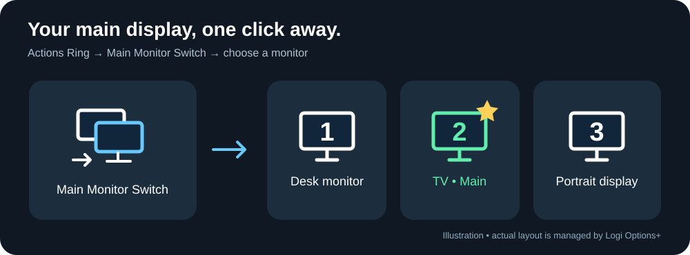

# Logi Monitor Switcher

**在 Logi Options+ 的 Actions Ring 中，直接选择要设为 Windows 主屏的显示器。**

[](https://github.com/flyrobin620/logi-monitor-switcher/actions/workflows/ci.yml)
[](LICENSE)

[English](README.md) | 简体中文



```text
Actions Ring
└── Main Monitor Switch
    ├── 显示器 1 — 桌面显示器
    ├── 显示器 2 — 电视         ★ 当前主屏
    └── 显示器 3 — 竖屏
```

从桌面显示器切到电视，再切回来，不必反复打开 Windows 显示设置。

> 这是独立开发的 Windows 社区插件，不是 Logitech 官方产品，也未获得其背书。它切换的是 **Windows 主显示器**，不是显示器的 HDMI/DP 输入源、KVM、亮度或电源。

## 功能

| 功能 | 实际行为 |
| --- | --- |
| 二级菜单 | 用 Actions Ring 原生文件夹组织显示器动作，点选即切换主屏。 |
| 真实显示器名称 | 读取硬件型号，同时显示编号、分辨率和主屏状态。 |
| 清晰图标 | 显示器轮廓内放大号数字；当前主屏使用绿色边框和金色星标，不只靠颜色区分。 |
| 主屏状态自动更新 | 插件切换后刷新；从 Windows 设置等其他入口切换，通常约三秒内更新。 |
| 按设备身份绑定 | 不依赖会变化的 `DISPLAY1/2/3`；兼容旧版保存的菜单动作。 |
| 导入向导 | 按选择的显示器生成带二级菜单和图标的 `.lp5` 配置副本，保留原配置。 |
| 独立运行 | 由 Logi Plugin Service 加载，不需要托盘程序、模拟快捷键或本地 HTTP 服务。 |

**请区分两种“动态”：** 名称、主屏状态和图标会自动刷新；原生文件夹里的**条目数量不会随插拔自动改变**。增减或更换显示器后，需要重新生成并导入配置，或手动调整绑定。单个文件夹最多九个显示器动作。

## 环境要求

- Windows 10 或 11，目标显示器已在 Windows 桌面中启用。
- 已安装 [Logi Options+](https://www.logitech.com/software/logi-options-plus.html) 和 **Logi Plugin Service**。
- Logitech 设备在 Options+ 中支持 Actions Ring；并非所有设备都支持。
- 从源码编译需要 [.NET 10 SDK](https://dotnet.microsoft.com/download/dotnet/10.0) 和本机插件服务提供的 `PluginApi.dll`。
- 单独运行导入向导需要 .NET 10 **Desktop Runtime**，或 Windows 版 .NET 10 SDK。

已在 Windows 和 Logi Plugin Service **6.4.2.3414** 上实际使用。不同版本的 SDK、配置格式或设备可能存在差异，不保证覆盖所有组合。插件本身使用 Logitech 宿主提供的运行时。

## 安装与配置

### 1. 编译

在 Windows PowerShell 中：

```powershell
git clone https://github.com/flyrobin620/logi-monitor-switcher.git
Set-Location .\logi-monitor-switcher
.\build.ps1
```

自定义 SDK 或插件服务路径：

```powershell
.\build.ps1 -Dotnet 'C:\Tools\dotnet\dotnet.exe' `
  -PluginApiDir 'C:\Program Files\Logi\LogiPluginService'
```

生成的文件：

| 文件 | 用途 |
| --- | --- |
| `dist\MonitorSwitcher_1.0.0.lplug4` | 插件安装包。 |
| `dist\MonitorSwitcher-Setup_1.0.0.zip` | 可选导入向导，须完整解压后运行 EXE。 |
| `dist\SHA256SUMS.txt` | 两个包的 SHA-256 校验值。 |

版本号来自插件的 YAML 元数据。编译只生成文件，**不会安装插件、修改布局或切换主屏**。分发包不包含 Logitech SDK DLL、调试符号、个人配置、日志或本地 SDK 路径。

### 2. 安装插件

双击 `.lplug4`，完成 Logitech 的安装流程。打开 Options+ 的 **Actions Ring → 自定义 Ring**，动作选择器中应出现：

**Monitor Switcher → Main Monitor Switch**

如果没有出现，退出 Options+，重启 **`LogiPluginService.exe` 进程**，再打开 Options+。它是插件宿主，不要与 Windows“服务”列表里名字相近的服务混淆。

这是本地安装，并不会自动上架 Logitech Marketplace。

### 3. 生成二级菜单

推荐运行导入向导：

```powershell
.\setup.ps1
```

1. 选择要复制的 Actions Ring profile；通用场景选择系统/全局配置。
2. 勾选 **1–9 台显示器**。如果原配置没有 `Main Monitor Switch` 文件夹，选择要在**副本中**替换的外层槽位。
3. 点击 **Generate import file**，把 `.lp5` 保存到 Logitech 配置目录之外。
4. 在 Options+ 的 profile 菜单中选择 **导入配置文件**，导入生成文件并切换到新 profile。
5. 打开 Ring → **Main Monitor Switch** → 选择目标显示器。

已有同名文件夹会在副本中重建，而不是新增一个重复文件夹。其他动作被保留，新配置使用新的 profile/package ID。外层是双显示器切换图标；子动作继续使用插件提供的实时图标，不会把生成时的主屏状态“烙死”在图标中。

确认副本工作正常前，请保留原配置。向导基于已验证的 `Loupedeck72` 格式；遇到不支持的结构会报错。创建新文件夹要求原配置只有一个模式、工作区和 Ring 页面。

**手动配置也可以：** 创建名为 `Main Monitor Switch` 的原生文件夹，再把各台显示器动作拖进去。构建后可在 `artifacts\plugin\icons\MainMonitorSwitch.svg` 和 `.ict` 找到外层图标，通过 Options+ 图标编辑器应用。不要给子动作覆盖静态图片，否则无法看到主屏星标自动变化。

> 切换主屏可能移动任务栏，并影响应用打开的位置。插件把目标屏的坐标平移到 `(0,0)`，保持各屏相对布局，不主动修改分辨率或重新排列屏幕。

## 与原来的 Monitor Switcher 有什么关系？

本仓库从 [Monitor Switcher](https://github.com/flyrobin620/monitor-switcher) 托盘/快捷键程序中拆出，但现在是独立项目：

- **原项目：** EXE 常驻托盘，注册快捷键，显示右键菜单。
- **本项目：** DLL 由 Logi Plugin Service 加载，在 Actions Ring 中提供显示器动作。
- **导入向导：** 只在配置时运行，不需要常驻。

本项目包含所需的 Windows 显示器代码，不会启动或调用 `MonitorSwitcher.exe`，不需要克隆原仓库，也不是它的子模块。


真实名称通过 `DisplayConfigGetDeviceInfo` 获取，按设备接口路径匹配；缺少硬件名称时回退到驱动描述或设备名称。枚举和状态更新不会切换屏幕，只有执行切换动作才调用 `SetDisplayConfig`。

## 为什么不是完全自动变化的二级菜单？

SDK 文档提供 `PluginDynamicFolder`，但该入口没有出现在测试版本的 Actions Ring 动作选择器中；也未找到公开 SDK 接口来修改用户现有的 Ring 布局。因此当前实现采用**原生文件夹＋带参数的插件动作**，不承诺运行时自动增减子项。

向导只读取配置，输出可导入的副本，再由 Logitech 正常导入。生成逻辑使用的是**内部且随版本变化的格式**，不是公开的布局写入 API。不会直接改运行中的 `ProfileInfo.json`。

## 限制与排错

| 情况 | 说明或处理方式 |
| --- | --- |
| `Display disconnected` | 确认显示器已连接并启用。Windows 源编号变化已兼容；设备身份真正变化时需重新绑定。 |
| `Display identity ambiguous` | 旧版设备 ID 匹配到多个显示器，插件不会猜测；从当前动作列表重新选择目标。 |
| 切换后星标没变化 | 等一个刷新周期；检查是否设置了用户自定义子图标，必要时恢复插件默认图标。 |
| 进入某个应用后菜单不同 | Options+ 支持应用专属 profile，请检查实际选中的配置。 |
| 插拔后仍是旧菜单数量 | 重新运行向导导入副本，或手动调整原生文件夹。 |
| 显示器名称仍然通用 | 该输出可能没有通过 Windows CCD 提供真实硬件名称。 |
| 编译找不到 `PluginApi.dll` | 安装 Logi Plugin Service 或传入 `-PluginApiDir`，不要从不明来源下载 DLL。 |
| 向导不支持当前格式 | 保留原配置，先手动配置，反馈宿主版本；不要通过手改实时 JSON 强行绕过检查。 |

移动连接端口或重装显卡驱动可能改变设备接口身份。屏幕编号跟随当前枚举顺序，绑定目标依据设备身份，而不是编号。镜像输出共用一个桌面源，不能独立选择为不同的主桌面。当前只支持 Windows，不涉及显示器输入源、亮度、电源或 macOS。

日志位置：

```text
%LOCALAPPDATA%\Logi\LogiPluginService\Logs\plugin_logs\MonitorSwitcher.log
```

## 开发与验证

```powershell
# 不需要 Logitech SDK 或真实显示器，不改变系统显示设置
dotnet run --project .\tests\MonitorSwitcher.Tests\MonitorMenu.Tests.csproj -c Release

# 完整构建：需要本机 Logitech SDK
dotnet build .\LogiMonitorSwitcher.sln -c Release

# 仅编译导入向导：不需要 Logitech SDK
dotnet build .\src\MonitorSwitcher.Setup\MonitorSwitcher.LogiSetup.csproj -c Release

# 只读查询当前显示器；真实名称检查需要至少一个报告硬件名称的输出
dotnet run --project .\tests\MonitorSwitcher.Tests\MonitorMenu.Tests.csproj -- --list
dotnet run --project .\tests\MonitorSwitcher.Tests\MonitorMenu.Tests.csproj -- --verify-live-names
```

GitHub Actions 在 Windows 上运行非破坏性回归检查并编译导入向导。CI 不下载、不提交 Logitech 专有 SDK，因此不在公共 runner 上编译插件 DLL；发布前仍需本地完整构建和硬件验证。

| 目录 | 内容 |
| --- | --- |
| `src\MonitorSwitcher.Plugin` | 插件动作、动态图标、旧配置兼容、包元数据。 |
| `src\MonitorSwitcher.Shared` | 显示器枚举、真实名称、Win32/CCD API。 |
| `src\MonitorSwitcher.Setup` | WinForms 向导、非破坏性 `.lp5` 生成。 |
| `tests\MonitorSwitcher.Tests` | 设备身份、名称、图标、配置生成与保留测试。 |
| `docs` | 示意图与维护/发布说明。 |

维护、开发加载及发布流程见 [Maintaining and releasing](docs/maintaining.md)。

## 隐私、反馈与许可

插件自身不实现遥测、登录或网络请求；Logitech 宿主的行为和隐私政策与本项目独立。

生成的 profile 会复制已有动作，可能含有个人路径、应用名称或自定义内容。**请勿把未经检查的 `.lp5`、`ProfileInfo.json`、日志或截图直接上传到公开 Issue。** 设备路径也可能包含本机硬件标识，分享前请脱敏。

欢迎通过 [GitHub Issues](https://github.com/flyrobin620/logi-monitor-switcher/issues) 反馈，附上 Windows/Options+ 版本、插件版本、显示器连接方式及脱敏复现步骤。欢迎贡献，尤其是不同设备和宿主版本的兼容性反馈。

本项目源码使用 [MIT 许可证](LICENSE)。显示器底层代码源自同样采用 MIT 的原 Monitor Switcher 项目。Logitech 及相关产品名称属于各自权利人；**MIT 许可证不涵盖 Logitech SDK 或软件**，本仓库不分发这些专有二进制文件。
